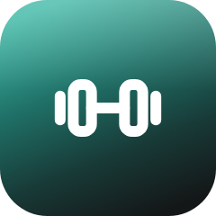
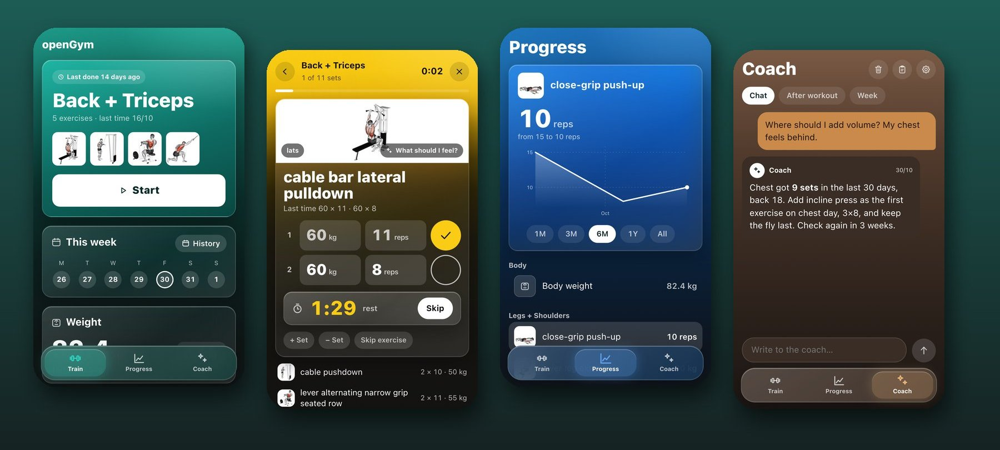
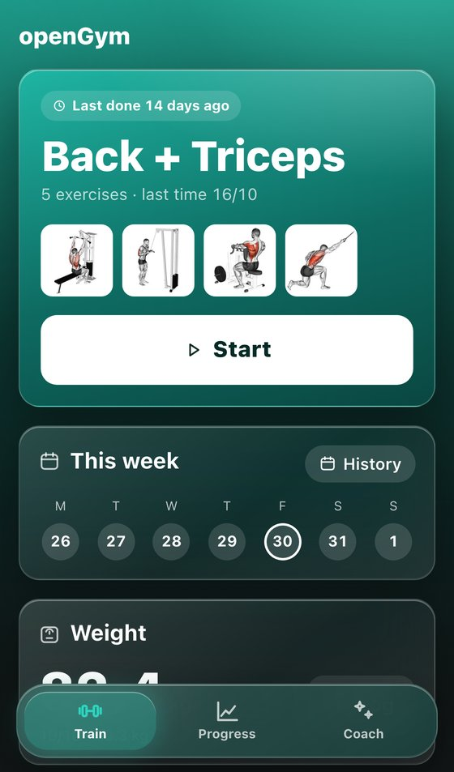
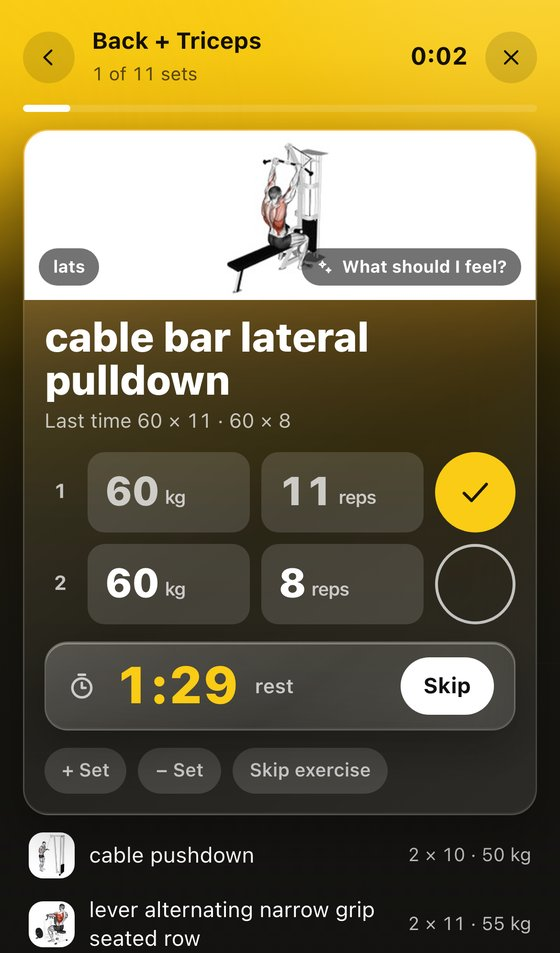
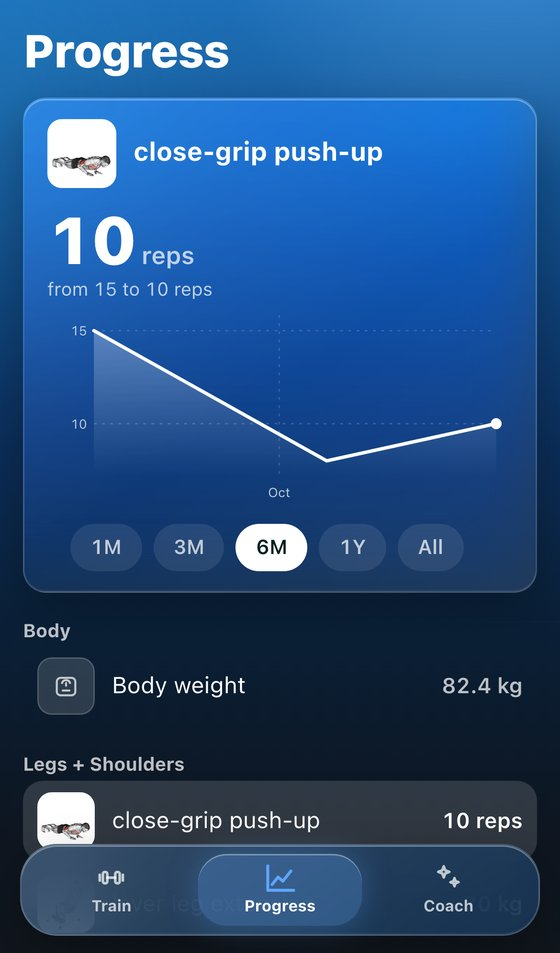
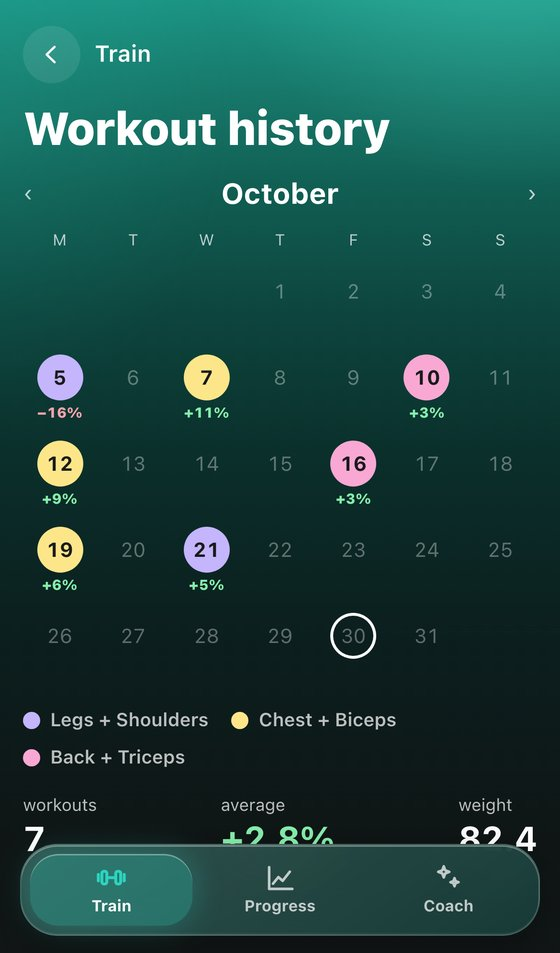
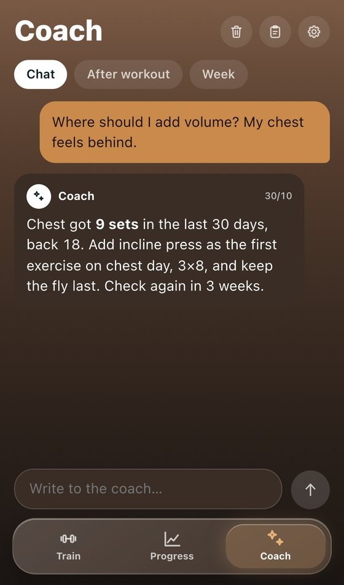
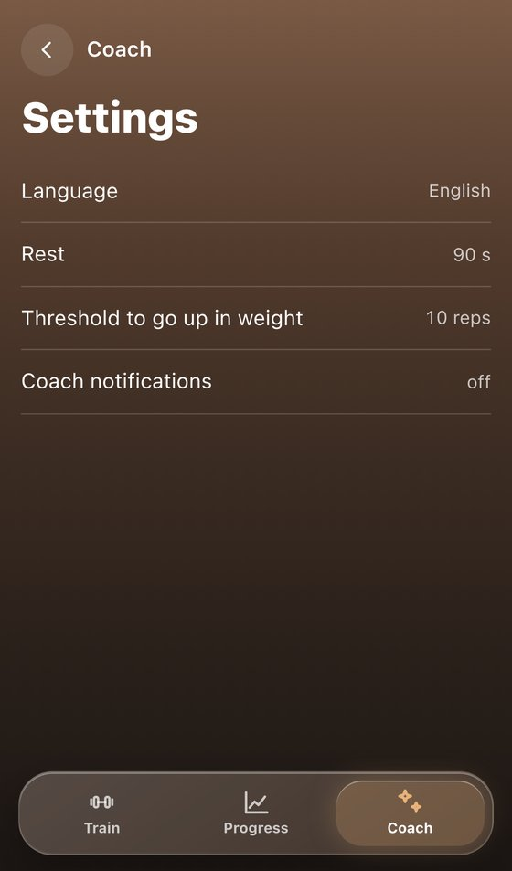
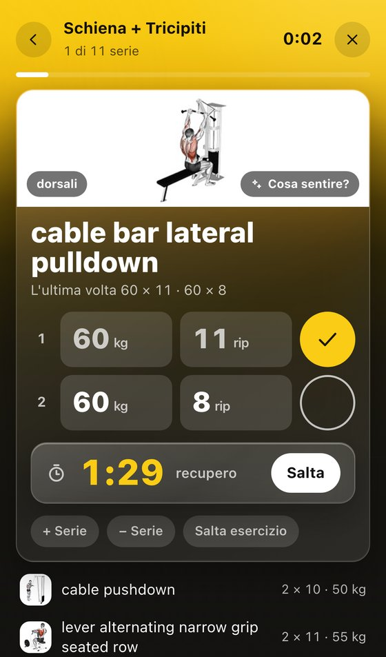
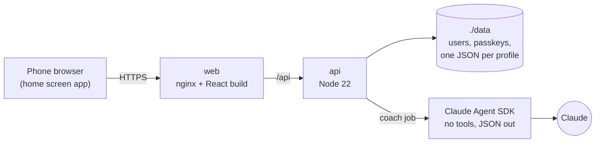

<div align="center">



# openGym, my version

**A gym log for your phone that remembers your last weights and has a coach who has read them.**
Self-hosted with Docker. Italian and English.

[](LICENSE)
[](frontend/package.json)
[](api/Dockerfile)
[](docker-compose.yml)



</div>

<br>

At the gym I want three things from my phone: what I lifted last time, a tick for each set,
and a timer for the rest. Everything else gets in the way. This is
[openGym](https://github.com/DuarteSantos8/openGym) by Duarte Santos, redesigned around that:
fewer screens, bigger buttons, and a coach that answers with my own numbers instead of
generic advice.

It runs on your own server and opens in the phone's browser. Add it to the home screen and it
behaves like an app.

<br>

## Train

<p align="center">


</p>

The home screen suggests the routine you have not done for the longest time. Start it and every
set comes **pre-filled with last time's weight and reps**. One tap ticks a set and starts the
rest timer. When you hit the rep threshold (10 by default), it asks whether to go up: +1, +2.5
or +5 kg.

During a workout you can add or remove sets, skip an exercise, add one you did not plan, or go
back to the other screens: the workout stays open until you finish or cancel it.

<br>

## Progress and history

<p align="center">


</p>

One chart, one list. Tap an exercise (or body weight) and the chart shows it, from one month
to all time. The calendar colours each day by routine and shows how much heavier or lighter it
was than the previous time.

<br>

## The coach

<p align="center"></p>

The coach reads your workouts, your body weight, and the diet or lab PDFs you upload, then
answers through Claude. It has three tabs:

- **Chat**: ask anything. Each answer reads the last 20 messages plus the facts it has noted
  about you, so a long chat does not blur its memory.
- **After workout**: two or three lines on what went up and what to try next time, also as a
  notification.
- **Week**: a Sunday recap.

Each tab can be cleared. What the coach has noted about you stays. During a workout,
**What should I feel?** gives a short cue for the exercise on screen.

The coach is optional and off until you connect it (see [Install](#install)). Each person also
has to accept it once, because it sends their data to Anthropic.

<br>

## Two languages

<p align="center">


</p>

The app starts in the phone's language: Italian if the phone is in Italian, otherwise English.
**Settings › Language** switches it, and the coach then answers in that language too.

<br>

## How it works



- **Sign-in with passkeys** (Face ID, fingerprint, PIN). No passwords, no email.
- **Your data stays on your server**, as plain JSON files in `./data`. The phone keeps a copy,
  so a workout keeps working without a connection and syncs the next time the app opens online.
- **The coach runs as a separate unprivileged process** with no tools and no file access. It
  gets a summary of your training and returns text.

<br>

## Install

You need Docker and, for passkeys, an HTTPS address (localhost works for a first try).

```bash
git clone https://github.com/stek765/opengym_my_version
cd opengym_my_version
cp .env.example .env          # set RP_ID and ORIGIN to your HTTPS address
./scripts/fetch-media.sh      # exercise pictures, about 11 MB
docker compose up -d --build
```

Open the address, create a profile, then on the phone use **Share › Add to Home Screen**.

**HTTPS.** Put the `web` container behind something that serves your hostname over HTTPS: a
reverse proxy, Cloudflare Tunnel, or `tailscale serve` for a server only you reach.

**Coach.** On a trusted computer with [Claude Code](https://claude.com/claude-code) run
`claude setup-token`, paste the value as `CLAUDE_SETUP_TOKEN=` in `.env`, and restart. The
server stores it encrypted in `./data` and turns the coach on. It uses your Claude
subscription, not an API key, so every profile on the server shares that subscription.

**Back up `./data`.** It holds everything: profiles, passkeys and workouts.

<br>

## Limits

- **Tested on one iPhone**, as a home screen app. Android and desktop browsers should work but
  have not been checked.
- **Exercise names from the library are in English** in both languages. Rename any exercise by
  holding its name during a workout.
- **No admin screen.** The server still supports invite codes and admin accounts, but only
  through its API.
- **The coach needs a Claude subscription** and counts against its limits. There is a daily
  cap per profile.
- **The exercise pictures are not in this repo.** They come from
  [hasaneyldrm/exercises-dataset](https://github.com/hasaneyldrm/exercises-dataset), which
  states no license, so the script downloads them from there.

<br>

## Project layout

```
api/             Node server: passkeys, sync, push, coach
  coach/         prompts, jobs, Claude adapter
frontend/        React app (Vite)
  src/views/     one file per screen
  src/locales/   it.js and en.js
web/             nginx image that builds and serves the frontend
scripts/         fetch-media.sh
docs/            README images
```

Tests: `cd frontend && npm test`, `cd api && npm test`.

<br>

## Credits and license

Based on [openGym](https://github.com/DuarteSantos8/openGym) by **Duarte Santos**, released under
the **GNU AGPL v3**, so this version is AGPL v3 too: if you run a modified copy for other people,
you have to offer them its source. See [LICENSE](LICENSE) and [NOTICE.md](NOTICE.md).

Exercise data and pictures: [hasaneyldrm/exercises-dataset](https://github.com/hasaneyldrm/exercises-dataset).
